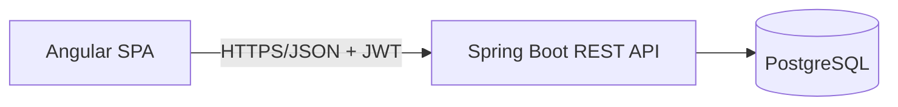

# CoopLedger

*Every member's share, in one ledger.*

A savings-and-loan cooperative (koperasi simpan pinjam) core system: member
registration, savings (pokok / wajib / sukarela), loans with installment
schedules, and automatic SHU (sisa hasil usaha) distribution. Built for small and
medium Indonesian cooperatives that still run on manual books.

## Stack

| Layer | Choice |
|---|---|
| Frontend | Angular 20 (standalone, Signals, Reactive Forms) |
| Backend | Java 21 + Spring Boot 3.5 (Maven) |
| Data | Spring Data JPA + Flyway, PostgreSQL 16 |
| Auth | Spring Security + JWT (BCrypt), role-based access control |

A deliberate **monolith** — one Spring Boot app + one Angular app. A cooperative
ledger is a transactional, multi-role domain where correctness and auditability
matter more than horizontal scale. No microservices, no Kafka, no rules engine.

## Quick start (local)

Prerequisites: Docker Desktop (Node 20+ only if you use the dev server).

```bash
# db :5432 + API :8080 + UI :4200 — one command
docker compose up --build

# open http://localhost:4200
```

The UI container (nginx) serves the built Angular bundle and proxies `/api` to
the backend container — same origin, no CORS needed.

Prefer hot reload while developing the UI? Both the container and the dev server
use port 4200, so stop the container first; the dev server proxies `/api` itself
(`frontend/proxy.conf.json`):

```bash
docker compose stop frontend
cd frontend && npm install && npm start
```

### Demo accounts

| Username | Password | Role |
|---|---|---|
| `admin` | `admin123` | Pengurus (ADMIN) |
| `teller` | `teller123` | Teller |
| `member` | `member123` | Anggota (MEMBER) |

Two members (Siti Rahayu, Budi Santoso) are seeded with savings accounts.

## Features

- **Role-based access** enforced on the server (401/403), not just the UI.
- **Members** — register, list, profile, per-member savings and transactions.
- **Savings** — pokok / wajib / sukarela accounts, deposits recorded by teller.
- **Loans** — apply → approve → disburse → installment schedule → pay. Flat
  rate interest (Indonesian koperasi style): `principal × rate × months/12`, with
  `sum(installments) == principal + totalInterest`.
- **SHU report** — surplus pool distributed proportionally to each active
  member's total savings.
- **Member self-service** — view savings, transactions, loans, and apply for a loan.

## Architecture



- **Money** is `BigDecimal` (scale 2) everywhere; never float/double.
- **Migrations** via Flyway (`backend/src/main/resources/db/migration/`); no
  `ddl-auto=update`.
- **Balance** is a derived column posted through `@Transactional`; an
  append-only double-entry ledger is on the roadmap.
- **Errors** use a consistent envelope (`code`, `message`, `traceId`) via
  `@ControllerAdvice`.

## API surface

| Method | Path | Roles |
|---|---|---|
| POST | `/api/auth/login` | public |
| GET / POST | `/api/members` | ADMIN, TELLER / ADMIN |
| GET | `/api/members/{id}` | ADMIN, TELLER |
| GET / POST | `/api/members/{id}/savings` and `/savings/deposit` | ADMIN, TELLER |
| GET | `/api/members/{id}/transactions` | ADMIN, TELLER |
| POST / GET | `/api/loans` | any authenticated / ADMIN, TELLER |
| GET | `/api/loans/{id}` | ADMIN, TELLER |
| POST | `/api/loans/{id}/approve`, `/reject` | ADMIN |
| POST | `/api/loans/{id}/disburse` | ADMIN, TELLER |
| POST | `/api/loans/{id}/installments/{n}/pay` | ADMIN, TELLER |
| GET | `/api/reports/shu?year=&pool=` | ADMIN |
| GET | `/api/me/*` | MEMBER |
| GET | `/api/health` | public |

## Tests

```bash
cd backend && mvn test
```

8 tests: the loan-flow integration test asserts the financial invariant, and the
RBAC test asserts 401/403 enforcement.

## Deploy

Deploy config is ready but not wired to accounts: `render.yaml` (Render
blueprint), `frontend/public/_redirects` (Cloudflare Pages SPA fallback), and
`.github/workflows/ci.yml`. Manual account/secrets steps are in
`project-brief.md` §10.

## Roadmap

1. Aging schedule + CKPN (allowance for doubtful receivables).
2. Double-entry accounting + balance sheet.
3. WhatsApp / SMS notifications.
4. Public member portal.
5. Report export (PDF/Excel) & Simkopdes integration.
6. Multi-branch.
