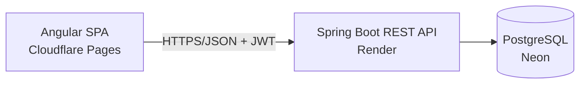

# CoopLedger

> *Every member's share, in one ledger.*

A web-based savings-and-loan cooperative (**koperasi simpan pinjam**) core system:
member registration, savings (pokok / wajib / sukarela), loans with installment
schedules, and automatic SHU (sisa hasil usaha) calculation — built for small-to-medium
Indonesian cooperatives still running on manual books.

## Stack

| Layer | Choice |
|---|---|
| Frontend | Angular 20 (standalone components, Signals, Reactive Forms) |
| Backend | Java 21 + Spring Boot 3.5 (Maven) |
| Data | PostgreSQL + Flyway migrations, Spring Data JPA |
| Auth | Spring Security + JWT (BCrypt), RBAC enforced server-side |
| Deploy | Cloudflare Pages (FE) · Render (BE) · Neon Postgres (DB) |

## Why Angular + Spring Boot

A savings-and-loan cooperative is a **transactional, multi-role domain**, and the stack
was chosen for exactly that:

- **Angular** — typed Reactive Forms for nested loan-application forms; lazy-loaded
  dashboards per role (pengurus / teller / member) with route guards; RxJS/Signals for
  interactive amortization tables.
- **Spring Boot** — `@Transactional` posts every savings/loan/installment atomically;
  `@Scheduled`-ready jobs for due dates and SHU; Spring Security RBAC with a real audit
  trail; JPA + Flyway for versioned, reproducible schema.

This is the same pairing used in production back-office and ERP finance systems
(QUALCO supply-chain finance, Swiss Re SPIRE, BNP Paribas CIB back-office).
**Honest caveat:** for a landing page or a small startup chasing velocity, React/Next
wins. Here the domain has real business rules, transactions, and roles — which is
exactly what this project demonstrates.

## Architecture

Monolith — one Spring Boot app + one Angular app. No microservices, no Kafka: for this
domain they add talking points without provable correctness.



Key decisions:
- **Monolith, not microservices** — deployable on free tiers, and a deliberate choice.
- **Mutable balance columns** posted through `@Transactional` for the MVP; an
  append-only double-entry ledger is on the roadmap.
- **Single writer per loan** for the MVP; pessimistic locking + idempotency keys are
  roadmap items.

## Money & correctness rules

- All money is `BigDecimal` (scale 2, HALF_UP). No float/double on any money path.
- Schema is owned by **Flyway** (`ddl-auto=validate`).
- Installment schedule guarantees `sum(installments) == principal + total interest`
  (flat-rate interest; the final installment absorbs the rounding remainder) — asserted
  in unit **and** integration tests.
- RBAC is enforced by the API (401/403), not just hidden in the UI — asserted in tests.
- DTOs only at the API boundary; entities are never serialized.
- Consistent error envelope (`code`, `message`, `traceId`) via `@ControllerAdvice`.

## Run locally

Prereqs: Docker.

```bash
git clone https://github.com/agaaaptr/coopledger.git
cd coopledger
docker compose up --build
```

- API: http://localhost:8080/api
- Frontend: http://localhost:4200 (`cd frontend && npm ci && npm start`)

Without Docker: point `DATABASE_URL`, `DB_USERNAME`, `DB_PASSWORD`, `JWT_SECRET` at any
Postgres (see `.env.example`), then `cd backend && mvn spring-boot:run`.

### Demo credentials

| Username | Password | Role |
|---|---|---|
| `admin` | `admin123` | ADMIN (pengurus) |
| `teller` | `teller123` | TELLER |
| `member` | `member123` | MEMBER (Siti Rahayu, M-0001) |

Seeded automatically on first boot.

### Try the core flow

```bash
# 1. Login
TOKEN=$(curl -s -X POST localhost:8080/api/auth/login \
  -H 'Content-Type: application/json' \
  -d '{"username":"member","password":"member123"}' | sed -E 's/.*"token":"([^"]+)".*/\1/')

# 2. Member applies for a loan (flat 12%/yr, 12 months)
curl -s -X POST localhost:8080/api/loans -H "Authorization: Bearer $TOKEN" \
  -H 'Content-Type: application/json' \
  -d '{"memberId":1,"principal":1000000,"interestRate":12,"termMonths":12}'

# 3. Admin approves, teller disburses, then pays installments 1..n
ADMIN=$(curl -s -X POST localhost:8080/api/auth/login -H 'Content-Type: application/json' \
  -d '{"username":"admin","password":"admin123"}' | sed -E 's/.*"token":"([^"]+)".*/\1/')
curl -s -X POST localhost:8080/api/loans/1/approve -H "Authorization: Bearer $ADMIN"
curl -s -X POST localhost:8080/api/loans/1/disburse -H "Authorization: Bearer $ADMIN"
curl -s -X POST localhost:8080/api/loans/1/installments/1/pay -H "Authorization: Bearer $ADMIN" \
  -H 'Content-Type: application/json' -d '{"amount":93333.33}'

# 4. SHU report (pool distributed proportionally to savings)
curl -s "localhost:8080/api/reports/shu?year=2026&pool=10000000" -H "Authorization: Bearer $ADMIN"
```

## Deploy

| Piece | Where | How |
|---|---|---|
| DB | [Neon](https://neon.tech) | Create project, copy the **`-pooler`** connection string |
| BE | [Render](https://render.com) | New → Blueprint → pick this repo (reads `render.yaml`). Set `DATABASE_URL` (JDBC format, `?sslmode=require`) as a secret env var |
| FE | [Cloudflare Pages](https://pages.cloudflare.com) | Connect repo, build `npm run build`, output `dist/frontend/browser` |

`JWT_SECRET` is generated by Render's blueprint (`generateValue: true`).
Manual steps checklist lives in `project-brief.md` §10.A.

## Roadmap

1. Aging schedule + CKPN (allowance for doubtful receivables)
2. Append-only double-entry ledger + balance sheet (`sum(debits) == sum(credits)`)
3. Idempotency keys + pessimistic locking with a concurrency test
4. WhatsApp / SMS notifications
5. Public member portal
6. PDF/Excel report export, multi-branch, Testcontainers in CI

## Tests

```bash
cd backend && mvn test
```

- `LoanMathTest` — unit: schedule sums exactly to principal + interest
- `LoanFlowIntegrationTest` — integration: apply → approve → disburse → pay-all completes the loan, invariant holds end-to-end
- `RbacTest` — 401 without a token, 403 with the wrong role, 200 with the right one

## License

MIT (placeholder — decide before selling).
