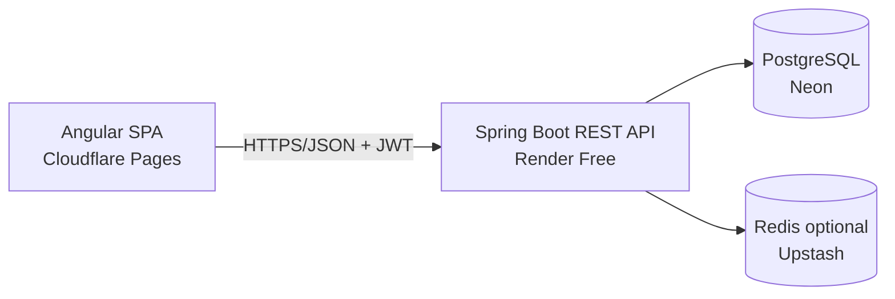

# CoopLedger — Project Brief

> This document is the context for an executor AI in a separate session. Goal: build the **CoopLedger** MVP in ±1 week, fullstack **Angular + Java Spring Boot**, 100% free hosting, with a clear product roadmap (not a dummy).

---

## 1. Summary

**CoopLedger** is a web-based savings-and-loan cooperative (koperasi simpan pinjam) core system: member registration, savings (pokok/wajib/sukarela), loans + installment schedules, and automatic SHU (sisa hasil usaha / surplus) calculation. A real product for small-to-medium Indonesian cooperatives still running on manual books.

Tagline: *"Every member's share, in one ledger."*

## 2. Goals

1. Demonstrate fullstack **Angular + Spring Boot** skills relevant to a banking / software-house placement.
2. Produce a product that is **genuinely usable & sellable**, not a demo dummy.
3. Ship an MVP in **±1 week**, with a clear 2–6 month roadmap.

## 3. Stack Justification (why Angular + Spring Boot, not Node/React)

A savings-and-loan cooperative is a transactional, multi-role domain — this is why the stack was chosen, and this argument belongs in the README:

**Angular** (frontend):
- Many nested forms (multi-step loan application, dynamic installment schedules) → **Reactive Forms**.
- Different dashboards per role (pengurus / teller / member) → **lazy-loaded modules + route guards**.
- Interactive amortization tables + complex data state → **RxJS / Signals**.

**Spring Boot** (backend):
- The core business is financial transactions → **`@Transactional`** to post savings/loan/installment atomically.
- Interest / due date / penalty / SHU → **`@Scheduled`** jobs.
- Strict role separation + audit trail → **Spring Security (JWT + RBAC)** + audit logging.
- Reports (SHU, arrears) → **PDF/Excel export**.

**Production evidence** (for the README argument): QUALCO (supply-chain finance), Swiss Re (SPIRE actuarial), BNP Paribas CIB, Hexaware (mortgage data correction), Munster Joinery (ERP service-management) — all run Angular + Spring Boot for back-office/ERP systems that need correctness & auditability. *(Full links in the References section.)*

**Honest caveat for the README:** for a landing page or a small startup needing maximum velocity, React/Next wins. Here the stack wins because the domain has real business rules, transactions, and roles — which is exactly what this project wants to demonstrate.

## 4. MVP Scope (1 week)

### In scope (must ship)
- **4 screens**: (1) pengurus dashboard, (2) member list + detail, (3) loan transactions (apply → disburse → installment schedule), (4) savings & SHU report.
- **1 core flow**: member applies for loan → pengurus approves → installments recorded → balance & SHU updated.
- Auth: login + 3 roles (ADMIN/pengurus, TELLER, MEMBER) with RBAC genuinely enforced (401/403, not just UI).
- Core data: `Member`, `Savings` (pokok/wajib/sukarela), `Loan`, `Installment`, `Transaction`, `User`.
- Flyway migrations (not `ddl-auto=update`).
- Money as `BigDecimal` (scale 2), **never** float/double.
- Seed data + demo credentials.
- Minimal tests: 1 unit + 1 integration test asserting a financial invariant (e.g. `sum(installments) == loan principal` in the happy path).

### Out of scope (cut for 1 week — goes to roadmap)
- Full double-entry ledger (single-entry that is correct + `@Transactional` is enough for MVP).
- Automatic penalties, collateral, loan restructuring.
- SHU implemented as a **simple rule** (e.g. proportional to savings), not full cooperative accounting standards (SAK ETAP/EP).
- Public member portal, WhatsApp notifications, payment integration, multi-branch.

## 5. Roadmap (2–6 months)

1. Aging schedule + CKPN (allowance for doubtful receivables).
2. Double-entry accounting + balance sheet.
3. WhatsApp / SMS notifications.
4. Public member portal (view balance & apply for loans).
5. Report export (PDF/Excel) & Simkopdes integration.
6. Multi-branch.

## 6. Architecture

**Monolith** (one Spring Boot app + one Angular app). No microservices, no Kafka, no rules engine — for this MVP they add talking points without provable correctness.



Architecture decisions to document in the README (with reasons):
- Monolith, not microservices (a junior who deliberately chooses a monolith reads as mature).
- Balance: **derived vs cached** — for MVP a mutable balance column is fine as long as it's posted through `@Transactional`; append-only ledger is on the roadmap.
- Locking: for MVP, a single writer per loan is enough; pessimistic locking + idempotency are roadmap items.

## 7. Stack & Versions

| Layer | Choice |
|---|---|
| Frontend | Angular 20 (standalone components, Signals, Reactive Forms, RxJS) |
| Backend | Java 21 LTS + Spring Boot 3.5.x (Maven) |
| Data | Spring Data JPA / Hibernate + Flyway |
| Auth | Spring Security + JWT (BCrypt) |
| Database | PostgreSQL 16/17 (Neon) |
| Local dev | Docker Compose (Postgres + backend) |
| CI | GitHub Actions (build + test FE & BE) |
| Deploy FE | Cloudflare Pages |
| Deploy BE | Render Free (Dockerfile) |

> Spring Boot 4.x exists but is newer; use 3.5.x for stability unless already familiar.

## 8. Definition of Done (reviewer credibility)

### Must (1 week)
- [ ] Real RBAC: endpoints return 401/403 when curled without a token / with the wrong role.
- [ ] Money = `BigDecimal` + explicit scale; no float/double on any money path.
- [ ] Flyway migrations versioned in git.
- [ ] `@Transactional` on every savings/loan/installment posting.
- [ ] Bean Validation (`@Valid`) at the API boundary; DTOs separate from entities (entities never serialized to JSON).
- [ ] `@ControllerAdvice` for a consistent error envelope (code, message, traceId).
- [ ] ≥1 financial-invariant test + ≥1 RBAC test.
- [ ] 60-second README (what/why/how-to-run/demo creds/architecture).
- [ ] Live demo: FE + BE + DB all reachable.

### Later (roadmap)
- [ ] Append-only double-entry ledger + `sum(debits)==sum(credits)` asserted in tests.
- [ ] Idempotency key (`X-Idempotency-Key`) for transfers/postings.
- [ ] Pessimistic locking + concurrency test (N parallel transfers → no money created or lost).
- [ ] Testcontainers (test against real Postgres, not H2).
- [ ] Green CI badge in README.
- [ ] Separate immutable audit log.

## 9. Reference Repos (patterns to borrow)

| Repo | What to borrow |
|---|---|
| [ozgucdlg/bankApp](https://github.com/ozgucdlg/bankApp) | Account/Transaction/Transfer domain model + transfer flow; one-command Docker Compose |
| [hendisantika/Online-banking-angular-springboot-mysql](https://github.com/hendisantika/Online-banking-angular-springboot-mysql) | Standard CRUD + role-separation layout |
| [OtmaneTouhami/digital-banking](https://github.com/OtmaneTouhami/digital-banking) | **`@Transactional` transfer + rollback**; `@ControllerAdvice` global handler; `@PreAuthorize` |
| [rogelioolarte/auth-alpaca](https://github.com/rogelioolarte/auth-alpaca) | Refresh-token rotation + JWT lifecycle (for more mature auth) |
| [mrin9/Angular-SpringBoot-REST-JWT](https://github.com/mrin9/Angular-SpringBoot-REST-JWT) | entity/repo/service/controller separation + JWT filter chain |
| [Cesar-Plyed/Role-Based-Dashboard](https://github.com/Cesar-Plyed/Role-Based-Dashboard) | RBAC matrix + admin dashboard layout |
| [nathangtg/jangular-cli](https://github.com/nathangtg/jangular-cli) | **Flyway migrations** + refresh-token JWT + project skeleton |
| [jroumpekas/eshop-app](https://github.com/jroumpekas/eshop-app-frontend) | Modern Angular (Signals + Reactive Forms) + admin route protection |

## 10. Setup: MANUAL (you) vs AUTOMATED (AI)

**Short answer:** not everything is automated. A few steps *you must do yourself* because they involve accounts, identity, and credentials — the AI cannot create accounts or hold your production secrets. Everything else (all code, deploy config, CI) the AI can do in one session.

### A. Manual — only you (needs account / browser / identity)

| # | Step | Notes |
|---|---|---|
| 1 | Create a **GitHub** account + a new (public) repo | The AI can commit & push *if* `gh` is already logged in on your machine; otherwise create the repo in the browser and give the AI the URL. |
| 2 | Create a **Cloudflare** account → Pages → connect the repo | Set build command `npm run build` and output dir `dist/<project-name>/browser`. The `_redirects` file (SPA fallback) is **written by the AI**, so you just click connect. |
| 3 | Create a **Render** account → connect the repo | The AI writes `render.yaml`; you just click "New → Blueprint" and pick the repo (Render reads `render.yaml` automatically). |
| 4 | Create a **Neon** account → create a Postgres project → copy the connection string | The AI provides the exact JDBC URL format; you paste in the real credentials. |
| 5 | Generate a JWT secret: `openssl rand -base64 48` | Set it as the `JWT_SECRET` env var in Render. **Do not commit.** |
| 6 | Set the `DATABASE_URL` env var (Neon connection string) in Render | Use the Neon `-pooler` URL (not the direct one). |
| 7 | (Optional) custom domain + DNS | Buy/point a domain, add the CNAME record. |
| 8 | (Optional) **UptimeRobot** ping to the Render URL | Prevents ~1 min cold start. *(Automated alternative: GitHub Actions cron — the AI can write it, see part B.)* |

### B. Automated — the AI does it in-session (without you)

- Scaffold the Angular + Spring Boot projects (or generate every file).
- All code: entities, DTOs, repositories, services, controllers, Angular components/services/guards/interceptors.
- Flyway migration SQL.
- Unit + integration tests (including invariant + RBAC tests).
- Multi-stage `Dockerfile` (lean image, `-Xmx320m` for Render's 512 MB) + `docker-compose.yml` (local dev).
- GitHub Actions CI: build + test FE & BE.
- `render.yaml` (Infrastructure-as-Code for Render).
- `_redirects` (SPA fallback for Cloudflare Pages).
- `.env.example`, `.gitignore`, `README.md` (run instructions, demo creds, Mermaid architecture diagram).
- Seed data + demo credentials.
- (Optional) GitHub Actions cron for keep-alive ping (UptimeRobot alternative).

## 11. Execution Order for the AI

1. Read this whole file.
2. Scaffold the monorepo (structure in section 12).
3. Backend first: entities + Flyway migrations + auth (JWT/RBAC) + savings/loan/installment endpoints + simple SHU + tests.
4. Frontend: auth + 4 screens + route guards + JWT interceptor.
5. Local run: `docker compose up` → verify the core flow end-to-end.
6. `render.yaml`, `_redirects`, `.env.example`, `README.md`.
7. Hand off to the user for the manual steps in part A (accounts + connect + secrets).
8. After the user sets the env vars, verify the live demo (FE + BE + DB reachable).

## 12. Repo Structure (monorepo)

```text
coopledger/
├── backend/                 # Spring Boot (Maven)
│   ├── src/main/java/...    # entity, dto, repository, service, controller, security, config
│   ├── src/main/resources/
│   │   ├── db/migration/    # Flyway SQL (V1__init.sql, ...)
│   │   └── application.yml
│   ├── src/test/java/...    # unit + integration
│   ├── Dockerfile
│   └── pom.xml
├── frontend/                # Angular
│   ├── src/app/             # modules: auth, member, loan, savings, report, dashboard
│   ├── public/_redirects    # SPA fallback for Cloudflare Pages
│   ├── Dockerfile
│   └── package.json
├── docker-compose.yml       # local dev (Postgres + backend + frontend)
├── render.yaml              # Render Blueprint
├── .github/workflows/ci.yml
└── README.md
```

---

### Summary for the executor AI

Build **CoopLedger**: a savings-and-loan cooperative system, Angular 20 + Spring Boot 3.5 (Java 21, Maven) + PostgreSQL (Neon). MVP = 4 screens + 1 core flow (loan apply → approve → installments → balance/SHU). Money = `BigDecimal`, migrations = Flyway, auth = JWT + RBAC (enforced), financial-invariant tests. Deploy: Angular to Cloudflare Pages, Spring Boot to Render (via `render.yaml`), DB to Neon. What the AI cannot do = create accounts, connect repos, generate/fill secrets — those are manual by the user (section 10.A). Monolith, don't over-engineer.
